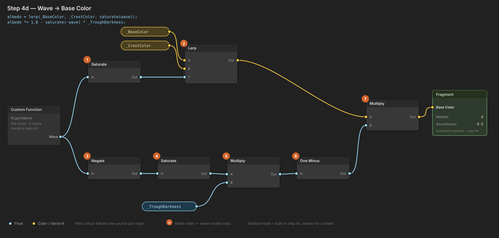

# Built-in → URP migration

Branch: `urp-migration`. Route A from the SFX/VFX plan — Shader Graph with a Custom Function
node carrying the ripple maths.

**Why:** three of the four Built-in constraints the SFX/VFX work would otherwise be structured
around — hand-pinned render queues, no soft particles, no post-processing — are workarounds that
disappear under URP. See [`Plan-SfxVfx.md` §1](Plan-SfxVfx.md) for the constraints and the
migration surface audit. Doing this before the SFX/VFX work avoids authoring trails and particle
materials twice.

---

## Status

| Done in code | Needs you, in the editor |
|---|---|
| URP added to `Packages/manifest.json` | Install / resolve the package |
| `Assets/Resources/WaterRipple.hlsl` — the ripple maths | Create the URP asset, assign to quality levels |
| `PlaceholderArt` — pipeline-aware shaders **and queues** | Build `WaterRippleURP.shadergraph` |
| `WaterRipples` — global ripple array (SRP Batcher safe) | Run the material converter for `rock.mat` |
| `AimPreview` — arc opted into `alwaysOnTop` | Verify, step by step, below |

Nothing is deleted. `WaterRipple.shader` (Built-in) stays as a working fallback for the length of
the migration, so the branch is playable at every step.

---

## Why I couldn't build the Shader Graph for you

`.shadergraph` files are serialized JSON node graphs — hundreds of lines of GUID-keyed schema that
varies between Unity versions. A hand-authored one that's subtly wrong fails in ways that look
like *your shader* is broken rather than like the file is malformed, which is the worst kind of
time to lose. So the maths lives in `WaterRipple.hlsl` (written, complete, commented) and the
graph is ~6 nodes of wiring in step 4.

**If step 4 turns out to be a slog, say so** — I can write a complete hand-authored URP Lit shader
that `#include`s the same `.hlsl` and needs zero editor work. The HLSL is shared, so switching
routes later costs nothing.

---

## Steps

Each step has an explicit pass check. Don't move on until it passes — the failures compound and
get much harder to attribute two steps later.

### 1. Import URP

`Packages/manifest.json` already requests `com.unity.render-pipelines.universal: 17.3.0`. Focus
the Unity editor; it will resolve and import on focus. Shader Graph and SRP Core come along as
dependencies — you don't need to add them.

> **If Unity reports it cannot resolve that version**, delete the line and instead use
> **Window → Package Manager → Unity Registry → Universal RP → Install**. That picks the
> version matching `6000.3.10f1` automatically. The version string is the only guess in this
> whole document.

**PASS:** Package Manager lists "Universal RP" as installed. Console has no resolution errors.
The game still runs exactly as before — importing URP alone changes nothing until step 2.

### 1b. Switch to Linear colour space

**Project Settings → Player → Other Settings → Color Space = Linear.**

URP's lighting math assumes Linear. Left in Gamma it still renders — which is why this is so easy
to miss — but every lit surface comes out oversaturated with wrong values, and you'll spend the
rest of the migration trying to fix it in material colours where it cannot be fixed.

This step was missing from the first version of this document, and it cost a full round of
debugging. See [`Findings-URPVisuals.md` §1](Findings-URPVisuals.md).

> Expect a long asset reimport, and expect the scene to look **different** immediately — usually
> darker. That's correct. Anything tuned by eye under Gamma will need retuning; don't revert.

**PASS:** `ProjectSettings/ProjectSettings.asset` contains `m_ActiveColorSpace: 1`.

### 2. Create and assign the URP asset

1. `Assets/Settings/` → **Create → Rendering → URP Asset (with Universal Renderer)**.
   Name it `RockSkippingURP`.
2. **Edit → Project Settings → Graphics** → set **Default Render Pipeline** to `RockSkippingURP`.
3. **Edit → Project Settings → Quality** → for **each of the 6 quality levels**, set
   **Render Pipeline Asset** to `RockSkippingURP`.

Step 3 matters and is easy to miss: a quality level with no pipeline asset silently falls back to
Built-in, so the game renders correctly for you and magenta for whoever ships on a different
quality level.

**PASS:** Enter play mode. Expect **magenta water and a magenta rock** — that is the correct
result here, not a failure. It means URP is active and the Standard-shader materials haven't been
converted yet. Steps 3 and 4 fix each one.

### 3. Convert `rock.mat`

**Window → Rendering → Render Pipeline Converter** → **Built-in to URP** → tick
**Material Upgrade** → Initialize → Convert.

`rock.mat` is stock Standard (`m_Shader: {fileID: 46}`), which is the one conversion the upgrader
handles perfectly. `RockSkipping_WaterRipple.mat` points at the custom shader and the converter
will leave it alone — that's step 4's job.

> This rewrites `.mat` files **in place**. Your tree is clean and you're on a branch, so
> `git checkout Assets/Resources/rock.mat` gets it back if anything looks wrong.

**PASS:** The rock renders grey again. Water is still magenta.

### 4. Build `WaterRippleURP.shadergraph`

**Create → Shader Graph → URP → Lit Shader Graph.** Save as
`Assets/Resources/WaterRippleURP.shadergraph`.

The name matters: `PlaceholderArt.CreateWater` looks for `WaterRippleURP` first and falls back to
the old `WaterRipple`. Two assets with the same name in one Resources folder makes
`Resources.Load` ambiguous, which is why the URP one gets a distinct name until the old shader is
deleted in step 7.

#### 4a. Graph Settings

| Setting | Value | Why |
|---|---|---|
| Surface Type | **Opaque** | The whole point — opaque means depth writes, which retires the render-queue workaround |
| Render Face | **Both** | Matches the original's `Cull Off` |
| Workflow Mode | Metallic | Matches the original `SurfaceOutputStandard` |

#### 4b. Blackboard properties

Reference names are load-bearing — C# and the authored material bind by reference string, not by
display name.

| Display name | Type | **Reference** | Default | Set by |
|---|---|---|---|---|
| Water Colour | Color | `_BaseColor` | `(0.06, 0.16, 0.28, 1)` | Material / `Material.color` |
| Crest Colour | Color | `_CrestColor` | `(0.55, 0.75, 0.95, 1)` | Material |
| Ripple Life | Float | `_RippleLife` | 2.5 | **C#** — `WaterRipples.PushTuning` |
| Front Speed | Float | `_RippleSpeed` | 6.0 | **C#** — `WaterRipples.PushTuning` |
| Ring Band Width | Float | `_RippleWidth` | 3.0 | Material |
| Wavelength | Float | `_RippleWavelength` | 2.5 | Material |
| Trough Darkening | Float | `_TroughDarkness` | 0.35 | Material |

`_BaseColor` rather than the original's `_Color`, and that is not cosmetic. `Material.color` binds
to whichever property carries `[MainColor]` — `_Color` under Standard, `_BaseColor` under URP/Lit.
The original shader's own remarks warn about exactly this: *"Named `_Color` because
`Material.color` maps to it. Rename it and the colour silently stops applying."* Same trap, new
pipeline. If your Shader Graph version offers a **Main Color** toggle in the property settings,
tick it.

Do **not** add `_Ripples` or `_RippleCount` as properties. Shader Graph has no array property
type; they are declared as global uniforms inside `WaterRipple.hlsl` and pushed by
`Shader.SetGlobalVectorArray`. That's covered in the comments in both files.

#### 4c. The Custom Function node

Add a **Custom Function** node:

- **Type:** `File` — **not** `String`. Inline strings are pasted inside a function body, so the
  array declaration would become a local and the global set would have nothing to bind to.
- **Source:** `Assets/Resources/WaterRipple.hlsl`
- **Name:** `RippleWave` — no `_float` suffix; Shader Graph appends the precision itself.

Ports, in this exact order (Custom Function binds positionally):

| Direction | Name | Type |
|---|---|---|
| In | `WorldPos` | Vector3 |
| In | `RippleLife` | Float |
| In | `RippleSpeed` | Float |
| In | `RippleWidth` | Float |
| In | `RippleWavelength` | Float |
| Out | `Wave` | Float |

Wire a **Position** node set to **World** space into `WorldPos`, and the four matching blackboard
properties into the rest.

#### 4d. Wave → colour

Seven nodes, reproducing the original's last three lines exactly:

```
albedo = lerp(_BaseColor, _CrestColor, saturate(wave));
albedo *= 1.0 - saturate(-wave) * _TroughDarkness;
```



The `Wave` output from the Custom Function node (dashed, built in 4c) forks into two branches:

| # | Node | Input from | Purpose |
|---|---|---|---|
| 1 | **Saturate** | `Wave` | Clamps crests to 0..1 — the `saturate(wave)` blend factor |
| 2 | **Lerp** | A = `_BaseColor`, B = `_CrestColor`, T = ① | The crest colour blend |
| 3 | **Negate** | `Wave` | Flips troughs positive, for `saturate(-wave)` |
| 4 | **Saturate** | ③ | Clamps troughs to 0..1 — anything that was a crest becomes 0 here |
| 5 | **Multiply** | A = ④, B = `_TroughDarkness` | Scales how dark a trough goes |
| 6 | **One Minus** | ⑤ | The `1.0 - …` darkening factor |
| 7 | **Multiply** | A = ②, B = ⑥ | Applies the darkening to the blended colour → **Base Color** |

Note the two branches carry different types: the top one becomes Color (Vector4) at the Lerp, the
bottom stays Float the whole way. Node ⑦ multiplies a Vector4 by a Float, which broadcasts across
all channels — that's the `albedo *= …` in the source line.

Master stack: **Metallic = 0**, **Smoothness = 0.5** — the Standard defaults the original
deliberately matched so an unrippled lake shades identically to before.

#### 4e. Point the material at the graph

Select `Assets/Resources/RockSkipping_WaterRipple.mat` → set its **Shader** to
`Shader Graphs/WaterRippleURP`. Re-enter the colour values from the table above; a shader swap
does not carry them over.

**PASS:** Enter play mode. The lake is the right dark blue, not magenta, not white, not grey.
If it's white or grey, `_BaseColor` isn't bound as main colour — recheck 4b.

### 5. Verify the ripples

Throw a rock (or use the debug HUD).

**PASS:** Expanding rings appear at each bounce and fade over ~2.5s.

**If the lake renders but no rings appear**, the global array isn't reaching the shader. In order
of likelihood:
1. Custom Function is in `String` mode, not `File` mode (4c).
2. Port names or order don't match the `RippleWave_float` signature in the `.hlsl`.
3. `MAX_RIPPLES` in the `.hlsl` no longer matches `WaterRipples.MaxRipples` (both 16).

### 6. Verify the draw order — this is the one that matters

This is the bug the whole `PlaceholderArt` queue-pinning workaround existed for, so it's the thing
most worth confirming actually got retired rather than reintroduced.

Throw a full-power rock and **watch it past z = 60** — the far half of the lake, where the water
plane's bounds centre sits. That's where the old bug triggered.

**PASS, all four:**
- The rock stays visible the whole way out. It does not vanish past the midpoint.
- The rock is drawn *over* the water, not behind it.
- The aim arc is visible over the water while aiming (it's `alwaysOnTop`).
- Ripples still render at the far end.

If the rock vanishes past the midpoint, depth writes aren't happening — check that the graph's
Surface Type is **Opaque** (4a), and that `rock.mat` converted to URP/Lit rather than staying on
Standard (step 3).

### 7. Clean up — only after 1–6 all pass

1. Delete `Assets/Resources/WaterRipple.shader` (+ `.meta`).
2. Rename `WaterRippleURP.shadergraph` → `WaterRipple.shadergraph`.
3. Simplify `PlaceholderArt.CreateWater` back to a single `Resources.Load<Shader>("WaterRipple")`.

**Do these as a separate commit from steps 1–6**, so if the URP water turns out to have a problem
in real play you can revert the deletion without unpicking the whole migration.

---

## Rollback

Everything is on `urp-migration` with a clean starting tree, so:

```bash
git checkout -- Packages/manifest.json Assets/
```

Then delete `Library/PackageCache/com.unity.render-pipelines.universal*` and let Unity re-resolve.
`main` is untouched throughout.

---

## Known issues to watch, not blockers

- **The aim arc's alpha gradient.** `AimPreview.BuildLine` sets `startColor` opaque and `endColor`
  at alpha 0.15, but the arc has been running on an *opaque* shader (Standard) the whole time, so
  that fade has never actually rendered. It won't under URP/Lit either. Not a regression — but if
  you want the fade, the arc wants an unlit transparent shader with vertex-colour support
  (`Universal Render Pipeline/Particles/Unlit`). Worth doing when the trail work lands in
  [`Plan-SfxVfx.md` §5.1](Plan-SfxVfx.md), since the trail needs the same kind of material.

- **Queue constants are now half-dead.** `WaterQueue` and `StoneQueue` are ignored under URP and
  only `ArcQueue` still does anything. Left in place because the Built-in path still reads them
  during the migration. Once step 7 is done, they can collapse to a single "draw the arc on top"
  concept — worth a follow-up so the constants stop implying a draw-order scheme that no longer
  exists.

- **Post-processing is now available and unused.** URP's `Volume` system is in. Bloom for sun
  glint on the lake was deferred as "needs PPv2, separate decision" — it isn't a package decision
  any more, just a taste one. [`Plan-SfxVfx.md` §6.11](Plan-SfxVfx.md).

- **Soft particles now work.** URP renders `_CameraDepthTexture` properly, so the splash particles
  in §6.5 can soft-blend against the water instead of hard-clipping. Enable
  **Depth Texture** on the URP asset when that work starts.

---

## What changed in code, and why

| File | Change | Reason |
|---|---|---|
| `Packages/manifest.json` | `+ com.unity.render-pipelines.universal` | — |
| `Assets/Resources/WaterRipple.hlsl` | **New.** Ripple maths + global array declaration | Custom Function payload. Maths ported verbatim; nothing in it was pipeline-specific |
| `WaterRipples.cs` | `Material.SetVectorArray` → `Shader.SetGlobalVectorArray` | Shader Graph has no array property type, so an array can't live in the `UnityPerMaterial` CBUFFER the SRP Batcher needs. Setting the global directly is the same operation without the ambiguity — and there's exactly one water plane, so global scope costs nothing |
| `PlaceholderArt.cs` | Pipeline-aware shader lookup | `Shader.Find("Standard")` under URP returns a shader that renders magenta |
| `PlaceholderArt.cs` | Queues honoured on Built-in, ignored on URP unless `alwaysOnTop` | **The important one.** URP picks the opaque or transparent pass *by render queue*. Pinning 3100 on an opaque material moves it to the transparent pass where depth writes are off — reproducing the exact bug the pinning was invented to fix |
| `AimPreview.cs` | Arc passes `alwaysOnTop: true` | It's a guide; under real depth sorting the water would occlude it |

---

## Related

- [`Plan-SfxVfx.md`](Plan-SfxVfx.md) — the work this unblocks.
- [`PLAN.md`](PLAN.md) — overall project plan.
